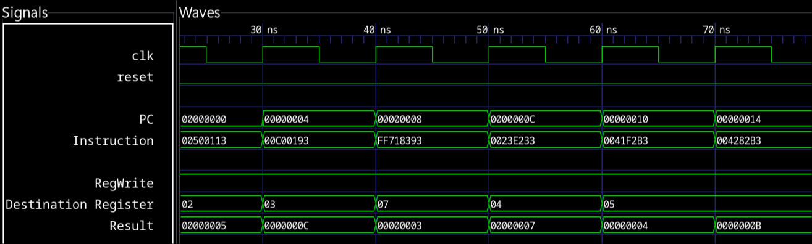
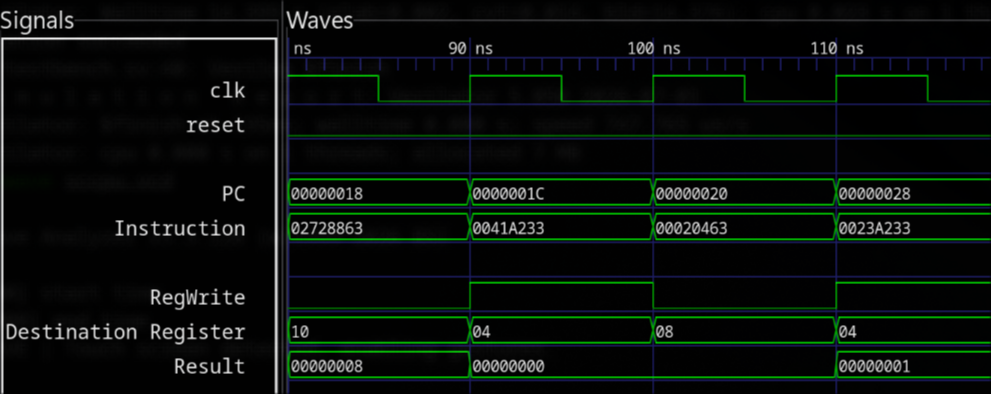
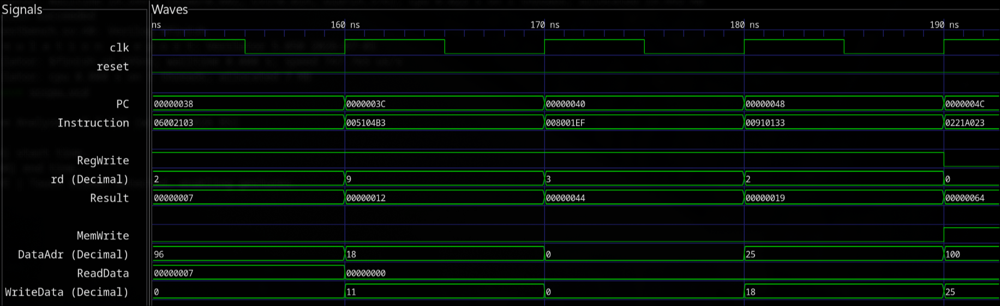

# Verification
Processors have been verified using the [reference validation program](../../software/asm/riscvtest.s) supplied with the Harris & Harris implementation.
The program executes arithmetic, logic, memory, branch, and jump instructions.
Successful execution is indicated by writing the value 25 to address 100 ('0x64').

| Signal | Hexadecimal | Decimal |
|---|---:|---:|
| `PC` | `0x0000004C` | 76 |
| `Instr` | `0x0221A023` | — |
| `MemWrite` | `1` | 1 |
| `DataAdr` | `0x00000064` | 100 |
| `WriteData` | `0x00000019` | 25 |


## Single-cycle Processor
### Arithmetic and register writeback
The first six instructions show correct immediate arithmetic, register arithmetic, logical operations, destination-register selection, and register-file writeback.


| PC | Instruction | Destination | Result |
|---:|---|---:|---:|
| `0x00` | `addi x2, x0, 5` | `x2` | `5` |
| `0x04` | `addi x3, x0, 12` | `x3` | `12` |
| `0x08` | `addi x7, x3, -9` | `x7` | `3` |
| `0x0C` | `or x4, x7, x2` | `x4` | `7` |
| `0x10` | `and x5, x3, x4` | `x5` | `4` |
| `0x14` | `add x5, x5, x4` | `x5` | `11` |


### Branch behavior
The branch at `PC = 0x18` is not taken because `x5 != x7`. 
The branch at `PC = 0x20` is taken because `x4 == x0`, causing execution to skip `PC = 0x24`.


|     PC | Instruction          | Branch behavior              | Result   |
| -----: | -------------------- | ---------------------------- | -------- |
| `0x18` | `beq x5, x7, end`    | Not taken; next PC is `0x1C` | —        |
| `0x1C` | `slt x4, x3, x4`     | —                            | `x4 = 0` |
| `0x20` | `beq x4, x0, around` | Taken; next PC is `0x28`     | —        |
| `0x24` | `addi x5, x0, 0`     | Skipped                      | —        |
| `0x28` | `slt x4, x7, x2`     | Branch target                | `x4 = 1` |


### Final program verification
The final instruction sequence loads the previously stored value, calculates the expected result, and writes it to the test address.

The `jal` instruction changes the PC directly from `0x40` to `0x48`, so the instruction at `0x44` is not executed. The final store satisfies the [testbench](../../tb/testbench.sv) success condition:

```text
MemWrite  = 1
DataAdr   = 0x00000064 # [100]
WriteData = 0x00000019 # 25
```

The processor writes `25` to address `100`, indicating success.



*The destination register, data address, and write data signals are displayed in decimal format for clarity.*

|     PC | Machine code | Instruction       | RegWrite | `rd` |             Result | MemWrite | Memory operation                                      |
| -----: | -----------: | ----------------- | -------: | ---: | -----------------: | -------: | ----------------------------------------------------- |
| `0x38` | `0x06002103` | `lw x2, 96(x0)`   |      `1` | `x2` |       `0x00000007` |      `0` | Read `0x00000007` from address `0x00000060`           |
| `0x3C` | `0x005104B3` | `add x9, x2, x5`  |      `1` | `x9` |  `0x00000012` (18) |      `0` | —                                                     |
| `0x40` | `0x008001EF` | `jal x3, end`     |      `1` | `x3` |       `0x00000044` |      `0` | Jump to `0x48`; save return address `0x44`            |
| `0x44` | `0x00100113` | `addi x2, x0, 1`  |        — |    — |                  — |        — | Skipped by `jal`                                      |
| `0x48` | `0x00910133` | `add x2, x2, x9`  |      `1` | `x2` |  `0x00000019` (25) |      `0` | —                                                     |
| `0x4C` | `0x0221A023` | `sw x2, 0x20(x3)` |      `0` |    — | `0x00000064` (100) |      `1` | Write `0x00000019` (25) to address `0x00000064` (100) |


## Multi-cycle Processor
